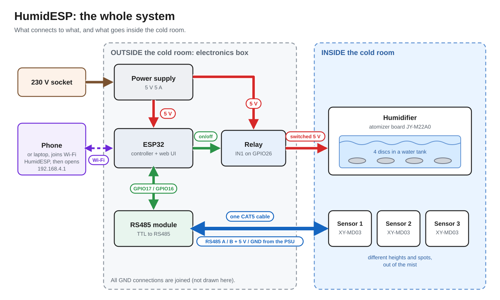
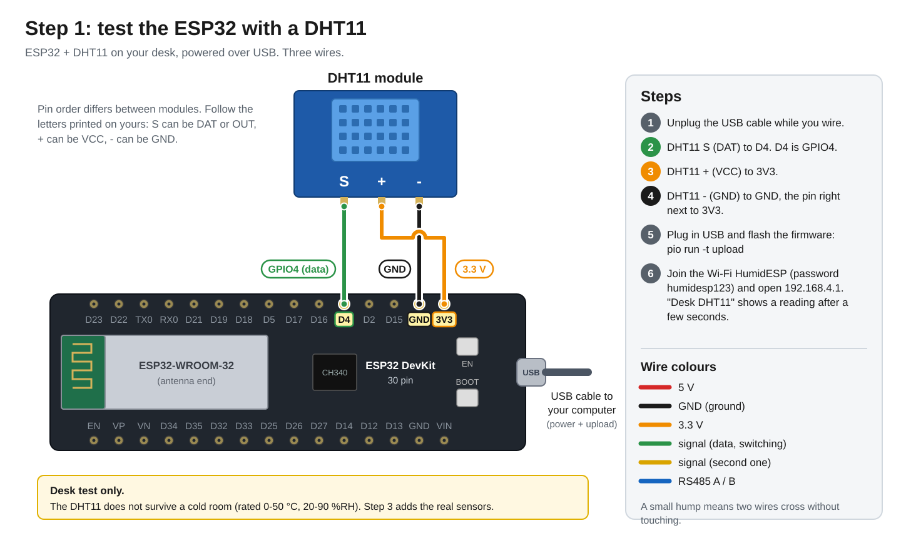
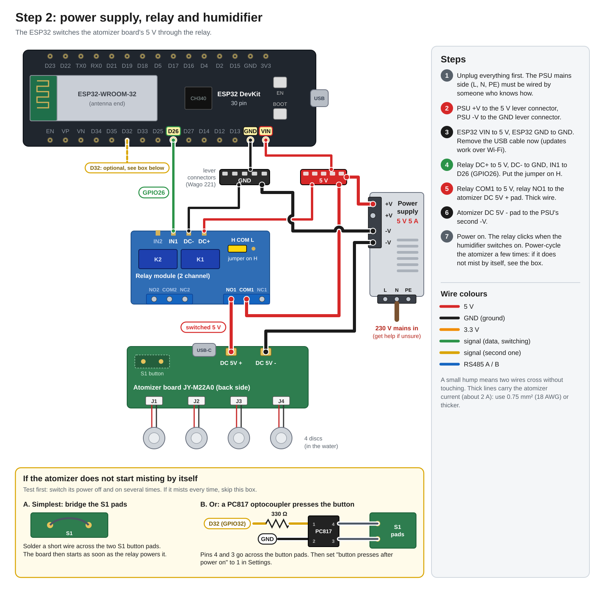
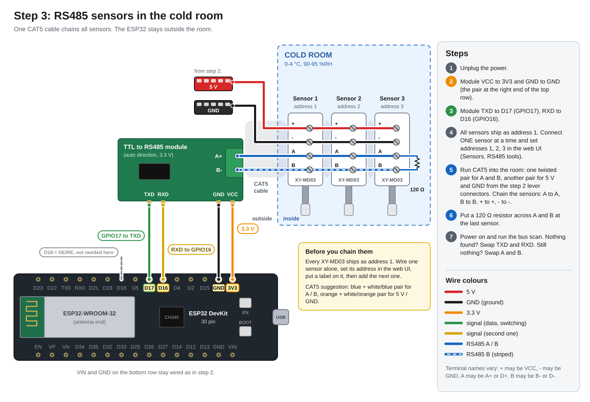

# HumidESP

ESP32 humidity controller for an apple cold-storage room (25-30 m², 0-4 °C, 90-95 %RH).
It runs its own Wi-Fi hotspot with a web dashboard, reads several sensors at different
spots and heights, switches ultrasonic humidifiers to hold a target humidity, and raises alerts.



## Features

- **Own hotspot** `HumidESP` (password `humidesp123`, change it in the UI) at http://192.168.4.1, with a captive portal.
- **Joins your home Wi-Fi** from the UI (scan, pick, connect). The hotspot stays on. On the LAN: `http://humidesp.local` or the IP shown in the header.
- **Up to 8 sensors**: RS485 Modbus (XY-MD02 style, FC3 transmitters, or custom register map), SHT3x/SHT4x on I2C, and DHT11/DHT22 for desk testing.
  Per-sensor calibration offsets and a "monitor only" option. Built-in Modbus bus scan and slave-address changer.
- **Room view**: set room size, then drag each sensor and humidifier to where it really is (top view) and to its height (side view). Shows an interpolated humidity heat map.
- **Control**: target RH with hysteresis, using the average, driest, or wettest control sensor. Min on/off time protects the relay. Two humidifier channels, each Auto / On / Off.
- **Safety and alerts**: low/high RH, low/high temperature (freezing / cooling failure), uneven humidity between sensors, sensor offline, no humidity rise while running (empty tank: auto stop until you press Resume), long run, optional water float switch.
  Alerts show in the UI, blink the onboard LED, optionally beep a buzzer, and can push to your phone via [ntfy](https://ntfy.sh) or any webhook (when on home Wi-Fi).
- **24 h history chart** per sensor (RH or temperature) plus event log.
- **Firmware update over Wi-Fi** from the System section, so you can leave it mounted in the room.
  On home Wi-Fi it also checks this repo's GitHub releases every 6 h and installs new ones by itself (can be turned off). Open pages reload on their own after an update.
- **Phone app (PWA)**: open the page on your phone and use "Add to Home screen" (Android Chrome menu, or iOS Safari Share button). While it is open, new alerts beep, vibrate and show in the tab title.
  Browsers only allow background push on HTTPS sites, which the ESP32 can't serve, so for notifications with the app closed set an [ntfy](https://ntfy.sh) topic in Settings and install the ntfy app.
- Optional **web password** (Settings → Web password, off by default). Login sessions survive reboots (last 8 devices).
  5 wrong passwords lock logins for 30 s, doubling up to 10 min. Forgot it? Hold the board's **BOOT** button for 10 s while it runs:
  the password and all sessions are cleared and the LED blinks fast.
- Optional **button-press emulation** (PC817 optocoupler) for atomizer boards that power up idle.

## Important: sensor choice for cold storage

The **DHT11 will not work** in an apple store: it is rated 0-50 °C and 20-90 %RH, with ±5 % accuracy.
Use sensors rated for low temperature and humidity near saturation. Best for this room:
**RS485 Modbus temperature/humidity transmitters** with a filter cap or probe. One twisted-pair cable daisy-chains
all of them over tens of metres, so the ESP32 can sit outside the cold room. Recommended: **XY-MD03** (SHT40, 0-100 %RH, waterproof probe, 5 V).
Avoid the SHT20-based XY-MD02: its manual rates humidity only to 80 %RH. Shopping list with links and QR codes: [docs/shopping.html](docs/shopping.html).

Placement for 25-30 m²: put 3-4 sensors at different heights and spots, for example low near the door,
the middle of the stack at about 1.5 m, high in the far corner, and one near the cooler's air return.
Keep them out of the direct mist plume and out of the evaporator's cold air blast.
Mist hitting a sensor makes it read 100 %.

## Hardware

| Part | Notes |
|---|---|
| ESP32-WROOM-32 DevKit (30 pin, CH340, USB-C) | the board you have |
| 5 V 5 A PSU | powers everything; keep it and the ESP32 in a box outside the cold room if you can |
| Relay module (5 V, H/L trigger jumper set to **H**) | switches the atomizer board's 5 V input |
| JY-M22A0 4-channel atomizer driver + discs | feed it from the `DC 5V + / −` pads on the back instead of USB-C |
| TTL-RS485 module, 3.3 V, auto direction | for Modbus sensors |
| RS485 temp/humidity sensors: **XY-MD03** (SHT40, 0-100 %RH, 5-28 V) | give each a unique address (UI → Sensors → RS485 tools) |
| MT3608 / XL6009 boost to 12 V | only for 10-30 V sensors like Renke RS-WS-N01 |
| 120 Ω resistor | across A-B at the far end of the RS485 cable |

### Wiring, step by step

Build it in three steps and test after each one. The overview at the top shows how the parts fit together.

**Step 1: desk test.** ESP32 and a DHT11 on USB, three wires, to check that the firmware and web UI work.



**Step 2: power and humidifier.** The 5 V supply powers everything, and the relay switches the atomizer board's 5 V.



**Step 3: cold room sensors.** An RS485 module and one CAT5 cable chain the XY-MD03 sensors inside the room.



### Pins

| ESP32 | Connects to |
|---|---|
| VIN / GND | PSU 5 V / GND |
| GPIO26 / GPIO27 | relay IN1 / IN2 |
| GPIO17 (TX2) / GPIO16 (RX2) | RS485 module TXD(DI) / RXD(RO). Swap if the scan finds nothing |
| GPIO18 | RS485 DE+RE (only for modules without auto direction) |
| GPIO21 / GPIO22 | I2C bus 1 SDA / SCL (SHT3x/SHT4x probe, cable up to about 2 m) |
| GPIO19 / GPIO23 | I2C bus 2 SDA / SCL (a second probe; most probes have the same fixed address 0x44) |
| GPIO4 | DHT11/DHT22 data (testing) |
| GPIO32 / GPIO13 | optional PC817 "button press" for humidifier 1 / 2 |
| GPIO33 | optional float switch to GND |
| GPIO25 | optional active buzzer module |
| GPIO2 | onboard LED: solid = humidifier on, blinking = alert |

Pins can be changed in [include/config.h](include/config.h).

### Atomizer board check

Unplug the board's power and plug it back in. If it starts misting without a button press, the relay alone is enough.
If it waits for a button, the simplest fix is to bridge the S1 button pads with a short wire (power-cycle it several times to check it starts every time).
Otherwise wire a PC817 optocoupler across the button (see the box in the step 2 diagram) and set
"button presses after power on" in Settings (usually 1). The relay still cuts power for a guaranteed off.

### Current budget

4 small 5 V atomizer discs draw around 1.5-2.5 A in total, the ESP32 up to 0.25 A, each relay about 70 mA.
That fits the 5 V 5 A supply. Use thick, short wires to the atomizer board.

## Build and flash

```bash
uv tool install platformio          # once
pio run -t upload                   # build + flash over USB
pio device monitor                  # serial log (115200)
```

Linux: your user needs serial access: `sudo usermod -aG dialout $USER` (then log out and in).

Optional: create `include/secrets.h` (gitignored) to pre-load home Wi-Fi on first boot:

```c
#define DEFAULT_STA_SSID "my wifi"
#define DEFAULT_STA_PASS "password"
```

Later updates: build with `pio run`, then upload `.pio/build/esp32dev/firmware.bin` from the web UI (System → Update firmware).

### Releases and auto-update

Push a tag like `v0.2.0` and the GitHub workflow builds `firmware.bin` and attaches it to a release:

```bash
git tag v0.2.0 && git push origin v0.2.0
```

Devices running a release build pick it up within 6 h (or press System → Check for update). A build flashed over USB reports
a `git describe` version and never replaces itself automatically, so press Install once to move it onto the release track.
Downloads are verified with GitHub's root certificates (`include/github_ca.h`).

## Cold-room tips

- Use **demineralised / RO water** in ultrasonic humidifiers, otherwise white mineral dust settles on the fruit and equipment.
- Mist should evaporate before it lands on apples. Aim it into the airflow from the cooler fan, not at the crates.
- Apples are typically stored around 0-4 °C and 90-95 %RH depending on variety. Set the temperature alarms so a cooling failure or freezing (below about -1 °C) reaches your phone.
- Put the electronics in an IP65 box with cable glands. Cold, wet air condenses on anything that gets cold and then warm.

## API

`GET /api/state`, `GET /api/history?n=60`, `GET /api/log`, `POST /api/settings`, `POST /api/sensors`,
`POST /api/channel {i, mode}`, `POST /api/resume`, `POST /api/bus`, `POST /api/modbus/scan`, `POST /api/modbus/setaddr`,
`GET /api/scan[?start=1]`, `POST /api/wifi {ssid, pass}`, `POST /api/wifi/forget`, `POST /api/test-alert`,
`POST /api/update` (multipart firmware), `POST /api/ota/check` (returns state with `ota`), `POST /api/ota/install`, `POST /api/reboot`, `POST /api/factory-reset`.
Public: `/manifest.json`, `/icon-180.png`, `/icon-512.png`.

With a web password set, every route above answers `401 {"error":"login required"}` without a valid `hsid` session cookie.
Open routes: `GET /api/auth` → `{enabled, loggedIn}` and `POST /api/login {password}` (sets the cookie; `403` wrong password,
`429` + `Retry-After` while locked out). `POST /api/logout` ends the current session.
`POST /api/password {current, password}` sets or changes it (4-64 chars, `current` only needed once one is set), `{current, remove:true}` removes it.
Changing or removing it ends all other sessions. `/api/state` only reports `auth.enabled`.
